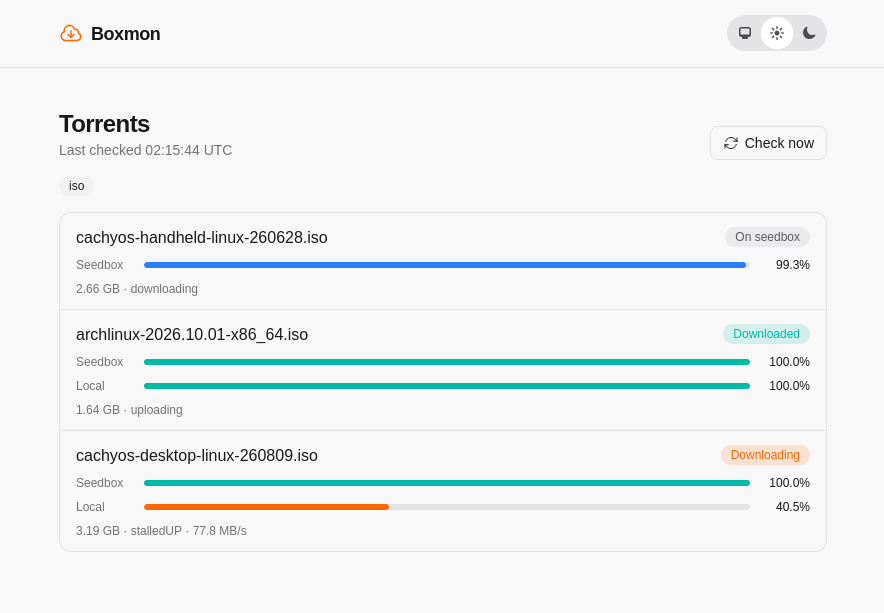

# Boxmon

Boxmon watches a remote qBittorrent client and downloads finished torrents to a
local directory over HTTP.

<p align="center">
  
</p>

## How it works

- **Downloads are found by path.** A file at `<save_path>/<name>` on the
  remote machine is fetched from `HTTP_URL/<path relative to REMOTE_ROOT>`, and saved
  at that same relative path under `DOWNLOAD_DIR`.
- **The local disk is the record of what's done.** Files that already exist
  locally at the right size are skipped. Nothing else is stored, so after a
  restart Boxmon re-checks every torrent and skips what's already there.
- **Files download to a `.part` file first,** then are renamed once complete.
- **Large files are split into parallel ranges.** When the file server
  supports byte ranges, files larger than `CHUNK_SIZE_MB` are downloaded in
  chunks of that size over `CONNECTIONS` parallel connections. Otherwise they
  download over a single connection.
- **Only monitored categories are touched.** Torrents outside `CATEGORIES` are
  neither shown nor downloaded. If `CATEGORIES` is empty, nothing downloads.

## Requirements

- **qBittorrent 5.2 or later,** with an API key generated under
  Options → WebUI.
- **An HTTP server on the remote machine serving its download directory,** optionally
  behind basic auth. Byte-range support is optional but makes large downloads
  faster.

## Configuration

Boxmon is configured with environment variables.

| Variable | Default | Description |
| --- | --- | --- |
| `QBIT_URL` | *required* | qBittorrent WebUI URL, e.g. `https://qbittorrent.example.com` |
| `QBIT_API_KEY` | *required* | qBittorrent API key |
| `HTTP_URL` | *required* | URL of the HTTP server serving `REMOTE_ROOT` |
| `HTTP_USER` | | Basic auth user for `HTTP_URL` |
| `HTTP_PASS` | | Basic auth password for `HTTP_URL` |
| `REMOTE_ROOT` | `/` | Seedbox directory that `HTTP_URL` serves |
| `DOWNLOAD_DIR` | `downloads` | Local directory to download into |
| `CATEGORIES` | *empty* | Comma-separated qBittorrent categories to download, e.g. `tv,movies,iso` |
| `CHUNK_SIZE_MB` | `128` | Size of each parallel range, in MiB |
| `CONNECTIONS` | `4` | Maximum parallel connections per file |
| `PORT` | `4000` | Port for the web dashboard |

`CATEGORIES` matching is exact and case-sensitive, and spaces after commas
aren't trimmed. Uncategorized torrents can't be monitored.

A production release also needs:

| Variable | Description |
| --- | --- |
| `PHX_SERVER` | Set to `true` to start the web server |
| `SECRET_KEY_BASE` | Generate one with `mix phx.gen.secret` |
| `PHX_HOST` | Hostname you open the dashboard at. The dashboard's live updates only connect from this host. |

The dashboard has no login. Don't expose it to the internet without putting
authentication in front of it.

### Example

qBittorrent saves to `/home/me/downloads/iso/linux.iso`, and nginx serves
`/home/me/downloads` at `https://remote.example.com/files`:

```sh
QBIT_URL=https://qbittorrent.example.com
QBIT_API_KEY=qbt_...
REMOTE_ROOT=/home/me/downloads
HTTP_URL=https://server.example.com/files
CATEGORIES=iso
DOWNLOAD_DIR=/media
```

The file is fetched from `https://remote.example.com/files/iso/linux.iso`
and saved to `/media/iso/linux.iso`.

## Development

`nix develop` provides Elixir, esbuild and Tailwind. Then:

```sh
mix setup        # install dependencies
mix phx.server   # start at http://localhost:4000 (also: just dev)
mix test
mix precommit    # compile with warnings as errors, format, and test
```

The development server needs the same `QBIT_URL`, `QBIT_API_KEY` and `HTTP_URL`
variables. Tests stub qBittorrent and the file server, so they need none.

If `mix.lock` changes, update the `fetchMixDeps` hash in `flake.nix`, or the
Nix build will fail.

### Nix release

With the configuration variables exported, `just run` builds and starts the
release on port 4000.
